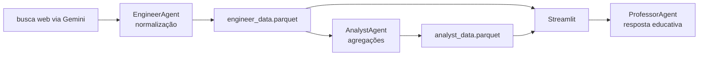

# O Guardião — educação sobre golpes digitais

Aplicação Streamlit que reúne um painel descritivo, conteúdo educativo e um chatbot apoiado por Gemini para falar sobre prevenção a golpes financeiros.

**Estado:** protótipo executável com dados Parquet versionados. O pipeline de coleta depende de uma API de IA e de busca, não há testes automatizados e as respostas do chatbot não devem ser tratadas como orientação jurídica, financeira ou de segurança garantida.

## Componentes



- `EngineerAgent`: solicita resultados sobre golpes, normaliza campos e acrescenta ao Parquet.
- `AnalystAgent`: calcula contagens e percentuais simples.
- `ProfessorAgent`: monta contexto com os dois Parquets e consulta o Gemini.
- `app.py`: interface de dashboard, conteúdo e chat.

## Executar

Pré-requisitos: Python compatível com as versões do `requirements.txt` e uma chave Gemini.

```bash
git clone https://github.com/lucasvidalsilva/o-guardiao.git
cd o-guardiao
python -m venv .venv
# Windows: .venv\Scripts\activate
# Linux/macOS: source .venv/bin/activate
pip install -r requirements.txt
```

Crie um `.env` local:

```dotenv
GEMINI_API_KEY=sua_chave
```

Depois:

```bash
streamlit run app.py
```

O painel pode usar os arquivos existentes em `data/`. A atualização do conteúdo ocorre pelas ações expostas na interface/orquestrador e depende do provedor externo.

## Dados e evidências

Os Parquets atuais permitem inspecionar o formato esperado, mas não comprovam cobertura do fenômeno, representatividade ou atualização contínua. A origem de cada registro, termos de uso e critérios de busca precisam ser versionados antes de apresentar métricas como pesquisa confiável.

## Limitações e segurança

- conteúdo gerado por IA pode conter erros e deve incluir fontes verificáveis;
- não há avaliação sistemática das respostas do chatbot;
- não há testes unitários, CI ou fixture sintética;
- `app.log`, `__pycache__` e bytecode estão versionados e deveriam ser removidos do Git;
- o pipeline acrescenta resultados ao Parquet sem uma chave de deduplicação explícita;
- a configuração YAML menciona planilhas, mas o fluxo atual usa Parquet;
- chaves devem permanecer somente no `.env` local.

Roadmap recomendado: proveniência por registro, deduplicação, testes das métricas, respostas com citações e um conjunto de avaliação para o chatbot.
